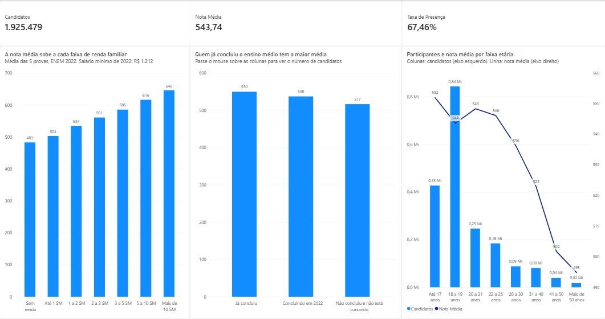
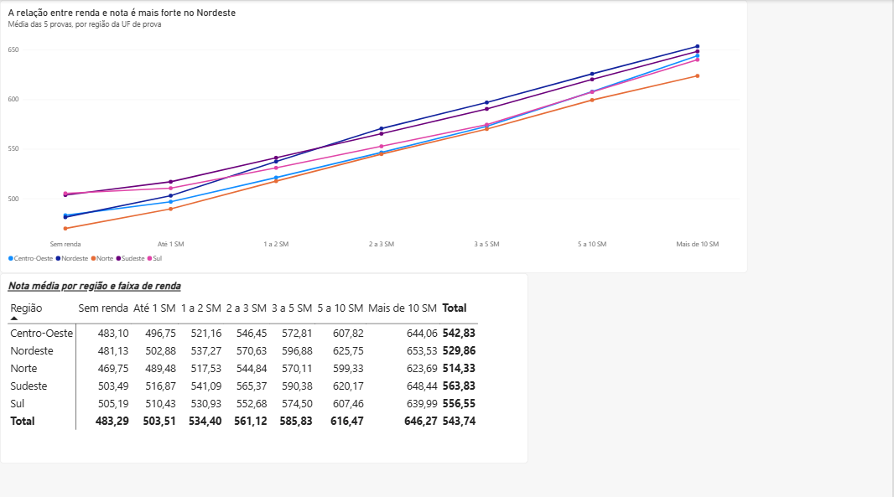
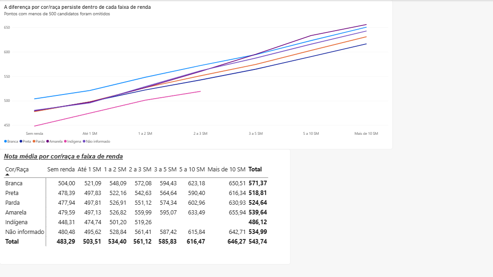
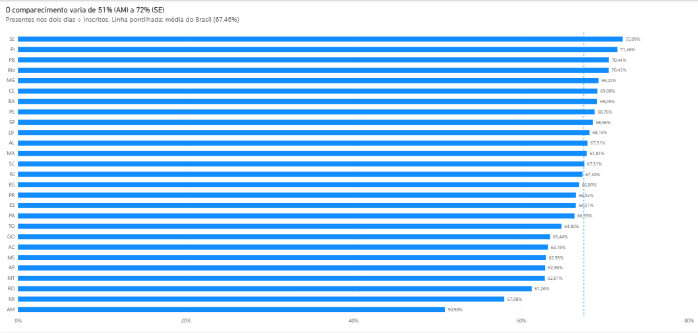

# Desempenho e comparecimento no ENEM 2022

Análise dos microdados do ENEM 2022 com **Python** (tratamento) e **Power BI** (modelagem e dashboard). O projeto investiga como a nota média dos candidatos se relaciona com renda familiar, região, cor/raça, situação de conclusão do ensino médio e faixa etária, e como o comparecimento à prova varia entre as unidades da federação.



---

## Sumário

1. [Perguntas de negócio](#perguntas-de-negócio)
2. [Principais resultados](#principais-resultados)
3. [Dados](#dados)
4. [Tratamento e decisões](#tratamento-e-decisões)
5. [Modelo de dados](#modelo-de-dados)
6. [Medidas DAX](#medidas-dax)
7. [Dashboard](#dashboard)
8. [Limitações](#limitações)
9. [Como reproduzir](#como-reproduzir)
10. [Próximos passos](#próximos-passos)

---

## Perguntas de negócio

| # | Pergunta | Métrica | Dimensão |
|---|---|---|---|
| 1 | Como a nota média varia conforme a situação de conclusão do ensino médio? | Nota média | Situação de conclusão |
| 2 | Como a nota média varia entre as faixas de renda familiar, e essa diferença muda de uma região para outra? | Nota média | Renda e região |
| 3 | Como a nota média varia por cor/raça, e quanto dessa diferença se mantém dentro da mesma faixa de renda? | Nota média | Cor/raça e renda |
| 4 | Qual a taxa de comparecimento (presentes ÷ inscritos) em cada UF? | Taxa de presença | UF |
| 5 | Como se distribuem os participantes por faixa etária e qual o desempenho de cada faixa? | Contagem e nota média | Faixa etária |

---

## Principais resultados

Todos os resultados de desempenho se referem à base tratada: **1.925.479 candidatos**, com nota média geral de **543,74** (média simples das cinco notas). Os resultados descrevem **associações**, não relações de causa e efeito (ver [Limitações](#limitações)).

### Renda familiar

A nota média sobe em todas as faixas de renda, sem exceção, de **483** ("Sem renda") a **646** ("Mais de 10 SM"): **163 pontos** de diferença, com degraus regulares de 20 a 30 pontos. Não há um ponto de virada; a associação acompanha toda a escada de renda.

Os grupos têm tamanhos muito diferentes: **551.767** candidatos na faixa "Até 1 SM" contra **83.564** em "Mais de 10 SM".

### Renda e região

A relação entre renda e nota **não é a mesma em todo o país**. A diferença entre a faixa mais rica e a mais pobre varia por região:

| Região | Sem renda | Mais de 10 SM | Diferença |
|---|---|---|---|
| Nordeste | 481,13 | 653,53 | **172,4** |
| Centro-Oeste | 483,10 | 644,06 | 161,0 |
| Norte | 469,75 | 623,69 | 153,9 |
| Sudeste | 503,49 | 648,44 | 145,0 |
| Sul | 505,19 | 639,99 | **134,8** |

- O **Nordeste** tem a associação mais forte: seus candidatos de menor renda estão entre os de menor média do país, e os de maior renda têm a maior média entre todas as regiões. A partir da faixa "2 a 3 SM", o Nordeste supera o Sudeste em todas as faixas.
- O **Norte** tem a menor média em todas as faixas de renda.

**Efeito de composição.** No total, o Nordeste tem média de 529,86 e o Sudeste de 563,83, uma diferença de 34 pontos. Mas, comparando candidatos da mesma faixa de renda, a diferença é bem menor, e o Nordeste fica à frente em quatro das sete faixas. A média total do Nordeste é puxada para baixo pela grande proporção de candidatos nas faixas de renda mais baixas, e não por um desempenho pior dentro de cada faixa. É um fenômeno da mesma família do paradoxo de Simpson: a comparação dos totais conta uma história diferente da comparação dentro dos grupos.

### Cor/raça e renda

| Diferença branca − preta | Pontos |
|---|---|
| **No total** | **52,6** |
| Dentro das faixas de renda | de 23,3 a 34,2 |

- **Cerca de metade da diferença desaparece** quando se comparam candidatos da mesma faixa de renda. Essa parte é composição: candidatos pretos estão concentrados nas faixas de renda mais baixas.
- **A outra metade persiste** em todas as sete faixas de renda.
- **A diferença cresce com a renda**, de cerca de 25 pontos nas faixas baixas para 34,2 na mais alta.
- Entre brancos e pardos, o padrão é semelhante: 46,7 pontos no total e de 20 a 26 dentro das faixas, com leve redução à medida que a renda sobe.
- **Indígenas** têm a menor média em todas as faixas com dados suficientes. Nas três faixas mais altas, o grupo tem menos de 500 candidatos (por exemplo, 220 em "5 a 10 SM" e 76 em "Mais de 10 SM"), e esses pontos foram omitidos (ver [Medidas DAX](#medidas-dax)).

A parte da diferença que persiste dentro das faixas não pode ser atribuída a uma causa específica com estes dados: a faixa de renda é um controle grosseiro, e fatores como tipo de escola e escolaridade dos pais não foram incluídos.

### Situação de conclusão do ensino médio

| Situação | Nota média |
|---|---|
| Já concluiu | 550 |
| Concluindo em 2022 | 538 |
| Não concluiu e não está cursando | 517 |

Contra a intuição de que quem está terminando o ensino médio teria vantagem por ter o conteúdo recente, quem **já concluiu** tem média 12 pontos maior. A hipótese mais provável é um **efeito de seleção**: "concluindo em 2022" reúne praticamente toda a turma de terceiro ano do país, enquanto quem volta a fazer a prova depois de formado tende a ser um grupo mais preparado (cursinho, segunda tentativa, foco em cursos concorridos). A hipótese não foi testada; um caminho seria comparar a distribuição de renda dos dois grupos.

O grupo "não concluiu e não está cursando" é pequeno (**6.880 candidatos**, 0,4% da base), mas suficiente para uma média estável (margem de erro de cerca de 2 pontos).

### Faixa etária

- A participação se concentra entre **18 e 19 anos** (cerca de 840 mil candidatos), quase o dobro da faixa "Até 17 anos" (cerca de 430 mil).
- A nota média é mais alta em "Até 17 anos" (552), cai levemente em "18 a 19" (544), se mantém até os 25 anos (548 e 546) e depois desce até 495 na faixa "Mais de 50 anos".
- A pequena queda entre "Até 17" e "18 a 19" é provavelmente composição: como os treineiros foram excluídos, quem tem até 17 anos é, em geral, quem conclui o ensino médio na idade esperada, enquanto a faixa de 18 e 19 anos inclui também quem conclui com atraso (distorção idade-série). É uma hipótese, não uma conclusão.

### Comparecimento

- **67,46%** dos inscritos estiveram presentes nos dois dias de prova. Ou seja, cerca de **um terço** dos inscritos não fez a prova completa.
- O comparecimento varia de **50,90% no Amazonas** a **72,09% em Sergipe**. O Amazonas fica sete pontos abaixo do penúltimo colocado (Roraima, 57,98%).
- Estados do **Nordeste** dominam o topo (Sergipe, Piauí, Paraíba e Rio Grande do Norte acima de 70%). **Norte e Centro-Oeste** concentram as menores taxas.
- 13 UFs ficam acima da média nacional e 14 abaixo.

Hipóteses como distância até os locais de prova e dificuldade de transporte são plausíveis, mas não foram testadas.

---

## Dados

- **Fonte:** [Microdados do ENEM 2022 — INEP](https://www.gov.br/inep/pt-br/acesso-a-informacao/dados-abertos/microdados/enem)
- **Arquivo:** `MICRODADOS_ENEM_2022.csv`, com cerca de 1,5 GB, separador `;` e codificação `latin-1`
- **Volume:** 3.476.105 inscritos, uma linha por inscrição
- **Dicionário de dados:** incluído no pacote do INEP; foi a referência para todos os códigos usados

Colunas utilizadas:

| Tema | Colunas |
|---|---|
| Identificação | `NU_INSCRICAO` |
| Notas | `NU_NOTA_CN`, `NU_NOTA_CH`, `NU_NOTA_LC`, `NU_NOTA_MT`, `NU_NOTA_REDACAO` |
| Presença | `TP_PRESENCA_CN`, `TP_PRESENCA_CH`, `TP_PRESENCA_LC`, `TP_PRESENCA_MT` |
| Perfil | `TP_FAIXA_ETARIA`, `TP_COR_RACA`, `TP_ST_CONCLUSAO`, `IN_TREINEIRO` |
| Localização | `SG_UF_PROVA` |
| Renda | `Q006` (renda mensal da família) |

As colunas mais pesadas do arquivo (`TX_RESPOSTAS_*`, `TX_GABARITO_*`, `CO_PROVA_*`) não foram lidas. Ler apenas as colunas necessárias com `usecols` permite processar o arquivo inteiro na memória de um computador comum.

A numeração das perguntas do questionário socioeconômico muda de um ano para outro. Em 2022, a renda familiar é a `Q006`; a identificação foi feita pelo dicionário do ano, e não presumida.

---

## Tratamento e decisões

### Funil de tratamento

| Etapa | Linhas | Removidas |
|---|---|---|
| Inscritos no arquivo | 3.476.105 | — |
| Presentes nas quatro provas (dois dias) | 2.344.823 | 1.131.282 |
| Sem treineiros | 1.927.753 | 417.070 |
| Sem nota zero nas provas objetivas | **1.925.479** | 2.274 |

### Decisões e justificativas

**Presença.** Foram mantidos apenas os candidatos com presença igual a 1 (presente) nas quatro provas. Os códigos de presença são 0 (faltou), 1 (presente) e 2 (eliminado). Antes de aplicar o filtro, foi verificado que **toda nota vazia corresponde a um candidato ausente ou eliminado**, e que nenhum candidato presente está sem nota. A presença de cada dia governa as provas daquele dia: a redação é feita no primeiro dia, com linguagens e humanas; ciências da natureza e matemática, no segundo.

**Nota única por candidato.** Entre analisar cada prova separadamente ou considerar só quem fez as duas etapas, optou-se pela segunda opção, com a **média simples das cinco notas** (`NOTA_MEDIA`). É mais simples de ler no dashboard. Essa média não é a nota usada por processos seletivos como o SiSU, em que os pesos variam por curso.

**Treineiros excluídos.** Treineiros fazem a prova sem concorrer a vagas e distorcem comparações de desempenho. Uma tabela cruzada mostrou que eles coincidem **integralmente** com a categoria 3 da situação de conclusão ("concluirá o ensino médio depois de 2022"). Por isso, a pergunta 1 compara três categorias: já concluiu, concluindo em 2022 e não concluiu nem está cursando.

**Redação com nota zero mantida.** A nota zero na redação é uma nota legítima, atribuída pela correção (fuga ao tema, texto em branco etc.). Excluí-la elevaria artificialmente as médias, provavelmente mais nas faixas de renda baixa.

**Nota zero nas provas objetivas excluída.** Pela Teoria de Resposta ao Item, usada na correção do ENEM, mesmo quem acerta pouco recebe nota bem acima de zero. Um zero numa prova objetiva, portanto, não parece ser resultado de desempenho. Na amostra exploratória, havia casos com zero nas quatro provas objetivas e 500 na redação. A **hipótese** é que se trate de registro de alguma situação irregular; a regra exata do INEP não foi verificada. A exclusão afetou 2.274 candidatos (0,1%).

**Cor/raça.** Os códigos 0 ("não declarado") e 6 ("não dispõe da informação") foram agrupados no rótulo "Não informado".

**Renda.** As 17 faixas da `Q006` foram agrupadas em 7, em salários mínimos (R$ 1.212 em 2022): sem renda; até 1 SM; 1 a 2; 2 a 3; 3 a 5; 5 a 10; mais de 10 SM. Com 17 faixas, os gráficos ficam ilegíveis e as faixas altas, com poucos candidatos, ficam instáveis.

**Faixa etária.** Os 20 códigos foram agrupados em 8 grupos: até 17 anos; 18 a 19; 20 a 21; 22 a 25; 26 a 30; 31 a 40; 41 a 50; mais de 50.

**UF.** Foi usada a UF de realização da prova (`SG_UF_PROVA`), que existe para todos os inscritos, inclusive os ausentes. Isso é necessário para calcular o comparecimento. A UF da escola só existe para parte dos candidatos.

**Formato Parquet.** A base tratada foi salva em Parquet, e não em CSV. Com o Windows em português, o Power BI tende a interpretar o ponto decimal de um CSV (`540.99`) como separador de milhar. O Parquet preserva os tipos das colunas, evita o problema e gera um arquivo muito menor. As dimensões, que só têm texto e números inteiros, foram salvas em CSV (UTF-8).

### Cuidados metodológicos

- **Amostras não aleatórias não servem para estimar proporções.** A exploração inicial usou as primeiras 100 mil linhas do arquivo (`nrows`), o que é adequado para conferir colunas, códigos e regras, mas não para estimar distribuições: as primeiras linhas não representam necessariamente o país. Todos os números deste README vêm do arquivo completo.
- **Validação cruzada entre Python e Power BI.** O número de candidatos no modelo (1.925.479) e a taxa de presença nacional (67,46%) foram conferidos com os totais calculados no Python. Nas matrizes, as linhas e colunas de total foram conferidas com os valores dos gráficos e dos cartões.

---

## Modelo de dados

O modelo é uma **constelação de fatos**: duas tabelas fato, com granularidades diferentes, que compartilham uma dimensão.

| Tabela | Tipo | Granularidade / conteúdo |
|---|---|---|
| `fEnem` | Fato | Uma linha por candidato: notas, `NOTA_MEDIA` e chaves |
| `fPresencaUF` | Fato | Uma linha por UF: inscritos e presentes |
| `dUF` | Dimensão | UF e região |
| `dRenda` | Dimensão | Faixa de renda agrupada e ordem |
| `dCorRaca` | Dimensão | Rótulo de cor/raça e ordem |
| `dConclusao` | Dimensão | Rótulo da situação de conclusão |
| `dFaixaEtaria` | Dimensão | Faixa etária agrupada e ordem |

Relacionamentos:

| De (fato) | Para (dimensão) | Cardinalidade | Filtro |
|---|---|---|---|
| `fEnem[SG_UF_PROVA]` | `dUF[SG_UF_PROVA]` | Muitos para um | Único |
| `fEnem[Q006]` | `dRenda[Q006]` | Muitos para um | Único |
| `fEnem[TP_COR_RACA]` | `dCorRaca[TP_COR_RACA]` | Muitos para um | Único |
| `fEnem[TP_ST_CONCLUSAO]` | `dConclusao[TP_ST_CONCLUSAO]` | Muitos para um | Único |
| `fEnem[TP_FAIXA_ETARIA]` | `dFaixaEtaria[TP_FAIXA_ETARIA]` | Muitos para um | Único |
| `fPresencaUF[SG_UF_PROVA]` | `dUF[SG_UF_PROVA]` | Muitos para um | Único |

Decisões de modelagem:

- **Por que uma segunda fato.** A `fEnem` só contém candidatos presentes; dentro dela, a taxa de comparecimento seria sempre 100%. A `fPresencaUF`, gerada a partir do arquivo original, guarda inscritos e presentes por UF.
- **A taxa não é armazenada, é calculada.** A `fPresencaUF` guarda contagens, não taxas. Assim, uma medida DAX calcula a taxa correta em qualquer nível (UF, região, Brasil). Guardar a taxa de cada UF levaria a erro ao agregar: a média das taxas das UFs dá o mesmo peso a Roraima e a São Paulo.
- **Relacionamento corrigido.** O Power BI detectou automaticamente a ligação entre `fPresencaUF` e `dUF` como um para um, com filtro bidirecional. Ela foi alterada para muitos para um, com filtro único: num modelo com duas fatos, o filtro bidirecional permitiria que filtros de uma fato chegassem à outra pela dimensão. Além disso, o modelo continua válido se a fato passar a ter mais de uma linha por UF (por exemplo, com outros anos).
- **Categorias sempre das dimensões.** Os visuais usam as categorias das dimensões (por exemplo, `dUF[SG_UF_PROVA]`), e não as colunas equivalentes das fatos, para que um mesmo filtro alcance as duas fatos.
- **Ordenação.** As colunas `ORDEM_RENDA`, `ORDEM_COR` e `ORDEM_IDADE` definem a ordem lógica dos rótulos (recurso "Classificar por coluna"). Sem elas, o Power BI ordenaria as faixas alfabeticamente ("1 a 2 SM" antes de "Sem renda").

---

## Medidas DAX

```dax
Candidatos = COUNTROWS(fEnem)

Nota Média = AVERAGE(fEnem[NOTA_MEDIA])

Nota Média (n ≥ 500) = IF([Candidatos] >= 500, [Nota Média])

Candidatos (texto) = FORMAT([Candidatos], "#,##0")

Taxa de Presença = DIVIDE(SUM(fPresencaUF[PRESENTES]), SUM(fPresencaUF[INSCRITOS]))

Taxa Brasil = CALCULATE([Taxa de Presença], ALL(dUF))
```

| Medida | Observação |
|---|---|
| `Candidatos` | Cada linha da `fEnem` é um candidato. |
| `Nota Média` | Respeita o contexto de filtro de cada visual. |
| `Nota Média (n ≥ 500)` | Devolve vazio quando o grupo tem menos de 500 candidatos, para que os gráficos não exibam médias instáveis. Com desvio padrão em torno de 85 pontos, a margem de erro aproximada é de ±11 pontos para 220 candidatos e de ±19 para 76. Usada nos visuais de cor/raça × renda. |
| `Candidatos (texto)` | Exibe o número exato no cartão (1.925.479), sem a abreviação automática ("2 Mi"). Serve só para exibição. |
| `Taxa de Presença` | Soma presentes e inscritos no contexto do visual e depois divide. `DIVIDE` devolve vazio em vez de erro se o divisor for zero. |
| `Taxa Brasil` | `ALL(dUF)` remove os filtros de UF; em qualquer barra, a medida devolve a taxa nacional. Usada como linha de referência no gráfico de comparecimento. A "linha média" pronta do Power BI não foi usada porque calcularia a média simples das 27 taxas. |

---

## Dashboard

O dashboard tem quatro páginas, do panorama geral para os cruzamentos e, por fim, para quem não fez a prova. Os títulos dos visuais enunciam o achado; os subtítulos trazem as definições.

**1. Perfil e desempenho:** totais, renda, situação de conclusão e faixa etária.


**2. Renda e região:** a relação entre renda e nota em cada região.



**3. Cor/raça e renda:** diferenças por cor/raça dentro de cada faixa de renda.



**4. Comparecimento:** taxa de presença por UF, com a média nacional como referência.



Escolhas de visualização:

- Gráficos de colunas começam no zero, porque a altura da coluna é a informação. Gráficos de linhas não precisam começar no zero, porque o que se lê é a posição e a inclinação.
- As linhas ligam os pontos com retas (interpolação linear), e não com curvas suavizadas: entre duas faixas de renda não existe dado, e uma curva sugeriria valores inexistentes.
- O número de candidatos aparece nas dicas de ferramenta, para que nenhuma média seja lida sem o tamanho do grupo por trás dela.
- No gráfico de faixa etária, de dois eixos, os rótulos de dados evitam a leitura errada da escala: o eixo da nota vai de cerca de 490 a 560, o que faz a linha parecer mais íngreme do que é.

---

## Limitações

- **Associação não é causalidade.** Renda, região, cor/raça e trajetória escolar estão interligadas; os gráficos mostram como a nota varia entre grupos, não por que varia.
- **A faixa de renda é um controle grosseiro.** Dentro de uma mesma faixa cabem rendas bem diferentes. Fatores relevantes ficaram fora da análise, como o **tipo de escola** e a escolaridade dos pais.
- **A base de desempenho é um recorte.** Os resultados de nota valem para quem esteve presente nos dois dias e não era treineiro; candidatos que faltaram a um dos dias não entram.
- **A nota é uma média simples das cinco provas,** diferente das notas ponderadas usadas nos processos seletivos.
- **A exclusão dos zeros nas provas objetivas se baseia numa hipótese,** não numa regra documentada do INEP.
- **A UF da prova não é necessariamente a UF de residência** ou da escola do candidato.
- **A renda é autodeclarada** no questionário socioeconômico.
- **Grupos pequenos têm médias instáveis.** Pontos com menos de 500 candidatos foram omitidos nos cruzamentos de cor/raça e renda.
- **Os dados são de um único ano.** Não é possível dizer se os padrões são estáveis ao longo do tempo.

---

## Como reproduzir

### Requisitos

- Python 3 com `pandas` e `pyarrow` (`pip install -r requirements.txt`)
- Power BI Desktop

### Passo a passo

1. Baixe os microdados do ENEM 2022 no [site do INEP](https://www.gov.br/inep/pt-br/acesso-a-informacao/dados-abertos/microdados/enem) e extraia o pacote em `dados/`, de modo que o arquivo fique em:

   ```
   dados/microdados_enem_2022/DADOS/MICRODADOS_ENEM_2022.csv
   ```

2. Rode os scripts na ordem, a partir da raiz do projeto:

   | Script | Função |
   |---|---|
   | `01_colunas.py` | Lista as colunas do arquivo |
   | `02_amostra.py` | Explora uma amostra: vazios, códigos de presença, renda, conclusão |
   | `03_base.py` | Valida as regras de tratamento na amostra |
   | `04_tratamento.py` | Gera a base tratada (`dados/tratados/enem_2022_base.parquet`) |
   | `05_dimensoes.py` | Gera as dimensões em CSV (`dUF`, `dRenda`, `dCorRaca`, `dConclusao`, `dFaixaEtaria`) |
   | `06_presenca_uf.py` | Gera a fato de comparecimento (`fPresencaUF.csv`) |

   Os scripts 04 e 06 leem o arquivo completo e podem levar alguns minutos.

3. Abra `powerbi/dashboard_enem.pbit` no Power BI Desktop. O arquivo contém o modelo, as medidas e os visuais, mas não os dados. As consultas apontam para `C:\projetos\projeto-enem\dados\tratados\`; se o projeto estiver em outra pasta, ajuste o caminho em **Transformar dados > Configurações da fonte de dados**.

### Estrutura do repositório

```
projeto-enem/
├── README.md
├── requirements.txt
├── .gitignore
├── scripts/           # 01 a 06, na ordem de execução
├── powerbi/
│   └── dashboard_enem.pbit
├── imagens/           # prints das páginas do dashboard
└── dados/             # não versionado: microdados e dados tratados
```

A pasta `dados/` não está no repositório: o arquivo original tem cerca de 1,5 GB, acima do limite do GitHub, e é público. Os scripts recriam todos os dados tratados a partir dele.

---

## Próximos passos

- Incluir o **tipo de escola** (pública ou privada) e testar quanto das diferenças por renda e por cor/raça se mantém dentro do mesmo tipo de escola.
- Testar a hipótese de seleção na situação de conclusão, comparando a renda de quem já concluiu e de quem está concluindo.
- Adicionar um visual com a **composição de renda por região**, que mostra diretamente o efeito de composição descrito acima.
- Repetir a análise para **outros anos** do ENEM, verificando se os padrões se mantêm.
- Parametrizar o caminho dos dados no Power Query, para o modelo abrir em qualquer pasta sem ajuste manual.

---

## Autor

**[Seu nome]**
[LinkedIn](https://www.linkedin.com/in/bruno-henrique-naz%C3%A1rio-sousa-0a4b07425/)
[GitHub](https://github.com/bnazario061)